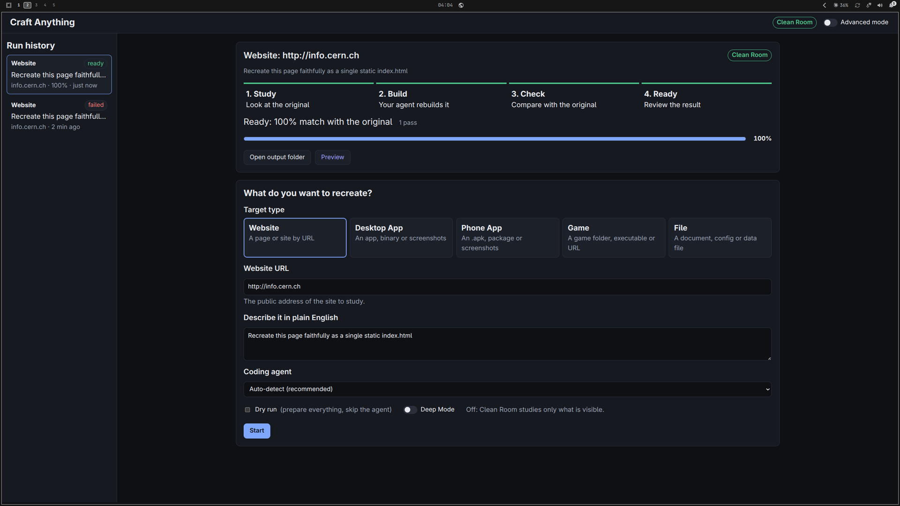
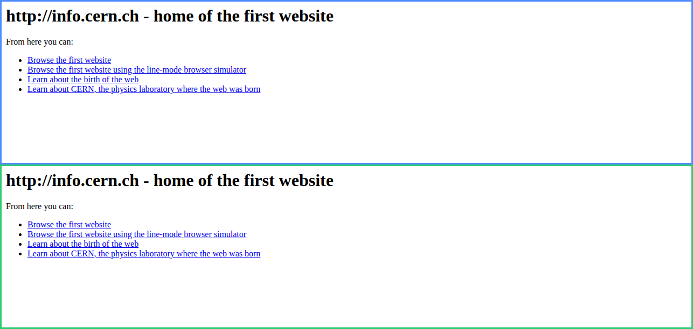
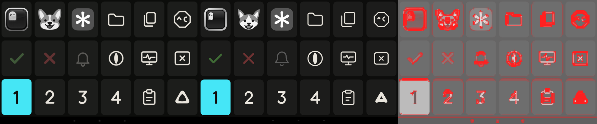
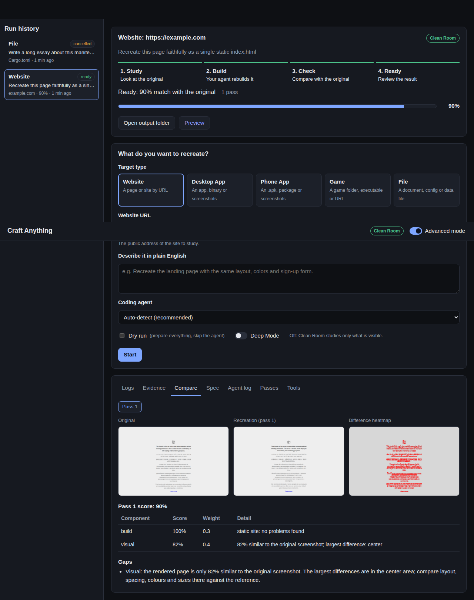
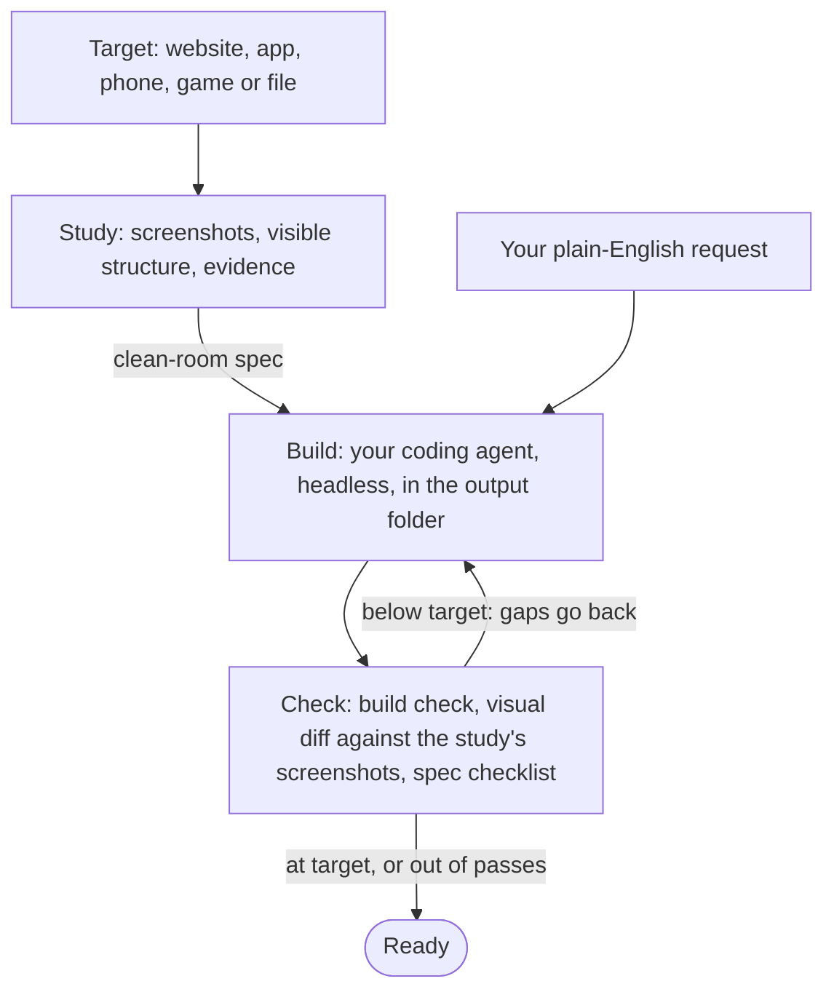

<p align="center">
  
</p>

<h1 align="center">Craft Anything</h1>



<p align="center">
  <strong>Point at a website, desktop app, phone app, game or file, say what you want in plain English,<br>and let your own coding agent rebuild it until it matches.</strong><br>
  Study → Build → Check → Ready. Clean-room by default, local-first, written in Rust.
</p>

<p align="center">
  
  
  
  
  
  
</p>

<p align="center">
  <a href="#what-it-is">What it is</a> ·
  <a href="#verified-proof">Verified proof</a> ·
  <a href="#how-it-works">How it works</a> ·
  <a href="#clean-room-and-deep-mode">Clean Room and Deep</a> ·
  <a href="#coding-agents">Agents</a> ·
  <a href="#install">Install</a> ·
  <a href="#use-it">Use it</a> ·
  <a href="#how-parity-is-scored">Scoring</a> ·
  <a href="#privacy-and-security">Privacy</a> ·
  <a href="#limits">Limits</a>
</p>

---

## What it is

Craft Anything recreates things you can see.

1. **Study.** It looks at the original the way a user would: screenshots at desktop and phone size, the visible structure, colours and fonts for a website; the public shape of a file; a window capture of an app or game; the current screen of a connected phone.
2. **Build.** It writes what it observed into a clean-room specification and hands that, with your request, to a coding agent you already have installed: `claude`, `codex`, `opencode`, `gemini`, `agy`, or any command of your own. The agent runs headlessly in an output folder. No extra API key is involved.
3. **Check.** It verifies the result builds, renders it, compares it with the original screenshot, and ticks off what the specification says must be visible.
4. **Ready.** If the match is below the target, the differences go back to the agent as concrete gaps and it tries again, up to the pass limit.

Two views sit on the same run:

- **Simple Mode** shows only the four steps, a plain status line and a match meter.
- **Advanced Mode** adds the live log, every captured artifact, a side-by-side comparison with a difference heatmap, the specification, the raw agent log and the tools check.

## Verified proof

Every claim here comes from a run on 2026-11-21 on Omarchy (Arch Linux, Wayland, Hyprland), started through the installed app with real coding agents. Each result was also checked by eye against the original.

### 1. From the app menu to a 100% match

Craft Anything was opened from the Omarchy Apps menu, and the form was filled in and started in its own window:

| Run | Details |
|---|---|
| Target | `http://info.cern.ch` (the first website) |
| Request | "Recreate this page faithfully as a single static index.html" |
| Mode and agent | Clean Room, `claude` |
| Result | Ready in one pass: build 100%, visual 100%, checklist 100% |

The original (blue border) above the page the agent built from the specification (green border):



### 2. Every target type (5 / 5)

| Target | What was studied | Mode | Result | Checked by |
|---|---|---|---|---|
| Website | `info.cern.ch` | Clean Room | 100% | Screenshots side by side |
| Website | `example.com` | Clean Room | 90% (visual 82%) | Heatmap: one-pixel text offsets only |
| File | A CSV of stock items | Clean Room | 100% | Running the parser the agent wrote; its total is correct |
| Desktop app | An open terminal window, captured live | Clean Room | 90% (visual 82%) | Screenshots side by side |
| Phone app | A connected Android tablet's screen, over `adb` | Clean Room | 90% (visual 76%) | Screenshots side by side |
| Game | A small web game folder | Clean Room | 100% | Screenshots side by side; the rebuilt game plays |
| Game, binary | The same folder and `/usr/bin/grim` | Deep, authorized | Findings produced | Stored apart, marked not clean-room safe |

For the CSV, the agent was given only the column names; the rows in its sample file are its own. That is the clean-room boundary doing its job.

The tablet's screen (left), the page rebuilt from it (middle), and the difference heatmap (right):



The web game (left), its recreation (middle), and the heatmap (right). The only difference is the falling dot, which is somewhere else because the game is running:


### 3. Four coding agents (4 / 4 tried)

Each recreated a website through its own headless command line, with no API key supplied by Craft Anything:

| Agent | Target | Result | Time |
|---|---|---|---|
| Claude Code (`claude`) | `info.cern.ch` | 100% in one pass | about 40 s |
| Codex CLI (`codex`) | `news.ycombinator.com` | 96% in one pass (visual 89%) | under 3 min |
| OpenCode (`opencode`) | `info.cern.ch` | 100% in one pass | about 20 s |
| Antigravity (`agy`) | `info.cern.ch` | 93% in one pass (visual 82%) | about 45 s |

Gemini CLI (`gemini`) is wired up the same way but has not been run live.

### 4. The refinement loop

To force a second pass, pass 1 was replaced with a deliberately rough draft:

| Pass | Score | What happened |
|---|---|---|
| 1 | 31% (build 100%, visual 3%, checklist 0 of 5) | The check reported the visual mismatch and each missing piece of text |
| 2 | 93% (build 100%, visual 82%, checklist 5 of 5) | The real agent received those gaps and rebuilt the page; the loop stopped above the 85% target |

Advanced Mode shows where an original and its recreation differ. Here the `agy` page looks the same but sits a few pixels lower, which the heatmap marks and the visual score counts:



### 5. What the live runs caught

Running everything for real found problems the automated tests had not, all fixed:

- A privacy-hardened browser refused plain-`http` pages, so the study failed. Plain Chromium is now preferred and blocked addresses are retried over `https`.
- OpenCode wrote its output to the wrong folder, because it takes its project folder from `$PWD`. That variable is now set for every agent.
- Antigravity's progress was unreadable in the log. It now has its own parser.
- A web game in a folder got no picture, because nothing was open to capture. Such folders are now rendered.
- A result verified only by the build check read as a "100% match". It is now labelled "build only".
- Agents wasted minutes trying to screenshot their own work. They are now told the Check stage does that.

### 6. Automated checks

`cargo test --workspace` passes 58 tests and `cargo clippy --workspace --all-targets -- -D warnings` is clean. The tests include end-to-end runs proving that bytes internal to a binary never reach a Clean Room prompt, that Deep mode is refused without confirmation, and that a running agent can be cancelled.

## How it works



| Crate | Role |
|---|---|
| `craft-core` | Domain model, clean-room spec, evidence store, event stream, and the pipeline with run ids and cancellation |
| `craft-browser` | Finds a Chromium-family browser and drives it headlessly over the DevTools protocol |
| `craft-inspect` | Study stage for websites, files, desktop apps, phone apps and games |
| `craft-agents` | Detects coding agents, runs them headlessly, and streams their output line by line |
| `craft-compare` | Check stage: build verification, visual similarity with a heatmap, spec checklist |
| `craft-app` | The `craft-anything` binary and the local web UI |

### Repository layout

```text
crates/
  craft-core/      model, clean-room spec, evidence store, events, pipeline
  craft-browser/   headless Chromium discovery and DevTools driver
  craft-inspect/   study: website, file, desktop app, phone app, game
  craft-agents/    agent detection, headless runner, output parsers
  craft-compare/   check: build verification, visual diff, spec checklist
  craft-app/       craft-anything binary, HTTP + SSE server, web UI
packaging/         per-user installer, launcher, desktop entry, icon
docs/assets/       screenshots used in this README
```

Every stage emits structured events. Simple Mode, Advanced Mode and the terminal output are three readers of that one stream, and each run's events and artifacts are kept on disk so past runs can be reopened.

## Clean Room and Deep mode

**Clean Room is the default.** The Study stage records only what can be observed from outside. The coding agent receives the specification, your request, the gaps from the previous check, and screenshots of the original. It never receives source code, bundles, decompiled code or the contents of a binary.

**Deep mode is opt-in, per run.** It adds network requests, script bundles, source maps and framework fingerprints for websites; headers, sections, imports and strings for binaries; manifests and resource listings for `.apk` and `.ipa` files; engine detection and an asset catalogue for games. It runs only when you switch it on *and* confirm you are authorized to inspect the target: a dialog in the UI, `--deep --confirm-authorized` on the command line. Nothing escalates to it automatically, and its findings are stored separately and marked as not clean-room safe.

Use Deep mode only on things you own or have permission to inspect.

## Coding agents

Craft Anything looks for these on your `PATH` and uses the first it finds, unless you pick one. Each runs headlessly in the output folder with edit permission and nothing more.

| Agent | Command used |
|---|---|
| Claude Code | `claude --output-format stream-json --verbose --permission-mode acceptEdits -p <prompt>` |
| Codex CLI | `codex -a never exec --json --skip-git-repo-check --sandbox workspace-write <prompt>` |
| OpenCode | `opencode run <prompt>` |
| Gemini CLI | `gemini --approval-mode auto_edit -p <prompt>` |
| Antigravity | `agy --output-format stream-json --mode accept-edits -p <prompt>` |
| Your own | `--agent "my-agent --flag"` runs `my-agent --flag <prompt>` |

Claude Code, Codex and Antigravity output is parsed into readable progress lines; the others are shown as they print.

## Install

Requirements: a Chromium-family browser (Chromium, Chrome, or `npx playwright install chromium`), and at least one coding agent for real runs.

**From the release (Linux x86_64, no Rust needed):**

```bash
curl -LO https://github.com/nodaysidle/nodaysidle-everything/releases/download/v0.1.0/craft-anything-0.1.0-linux-x86_64.tar.gz
tar xzf craft-anything-0.1.0-linux-x86_64.tar.gz
craft-anything-0.1.0/packaging/install.sh
```

**From source (needs Rust and Cargo):**

```bash
git clone https://github.com/nodaysidle/nodaysidle-everything.git
cd nodaysidle-everything
packaging/install.sh
```

Either way it installs, for your user only:

- `~/.local/bin/craft-anything`, the program
- `~/.local/bin/craft-anything-app`, a launcher that starts the local server and opens the UI as an app window
- an application entry and icon, so **Craft Anything** appears in the Omarchy Apps menu

Runs are stored in `~/.local/share/craft-anything/runs`. Remove everything except that data with `packaging/install.sh --uninstall`.

Check what is available on your machine:

```bash
craft-anything doctor
```

Everything beyond the browser and one agent is optional and discovered at run time. A missing tool skips its probe with a message; it never fails a run.

| Tool | Used for |
|---|---|
| `adb` | Phone apps: device screenshot and visible UI tree |
| `grim` + `hyprctl` | Desktop apps and games: capturing the app's window on Hyprland |
| `screencapture` | The same on macOS (whole screen) |
| `sqlite3` | Reading the schema of SQLite files |
| `node`, `npm`, `python3`, `cargo` | Checking that what the agent built is well-formed |

## Use it

**From the app menu:** open *Craft Anything*, pick a target type, enter the URL or path, describe what you want, press **Start**.

**From the terminal:**

```bash
# Recreate a website with the first agent found
craft-anything run --target website --source https://example.com \
  --prompt "Recreate this page as a single static index.html"

# Pick the agent and see the full log
craft-anything run --target website --source https://example.com \
  --prompt "Recreate this page" --agent codex --advanced

# A desktop app from screenshots you took
craft-anything run --target desktop-app --source ~/Pictures/my-app-shots \
  --prompt "Rebuild this settings window as a web page"

# See the prompt the agent would get, without running it
craft-anything run --target file --source data.csv --prompt "Write a parser for this" --dry-run

# Deep mode, on something you are authorized to inspect
craft-anything run --target file --source ./my-tool --prompt "Document this binary" \
  --deep --confirm-authorized

# Start the web UI without the launcher
craft-anything ui            # http://127.0.0.1:7420
```

What each target accepts:

| Target | Source |
|---|---|
| Website | A URL, or a local `.html` file |
| Desktop app | An executable, `.desktop` file or app bundle (its open window is captured), or a folder of screenshots |
| Phone app | A package name or `.apk`/`.ipa` (the connected phone's current screen is captured; open the app first), or a folder of screenshots |
| Game | A game folder or executable (three frames of its open window), a web game by URL or as a folder with an `index.html` (rendered), or screenshots |
| File | Any file or folder: JSON, CSV, SQLite, zip, tar, images, text |

## How parity is scored

| Signal | Weight | What it measures |
|---|---|---|
| Build | 0.3 | `cargo check`, `npm run build` when dependencies are installed, JavaScript and Python syntax, JSON validity, and missing files referenced by HTML |
| Visual | 0.4 | The output's `index.html` rendered at the original screenshot's size and compared block by block; a heatmap shows where they differ |
| Checklist | 0.3 | Every piece of text the specification says must be visible is looked for in the result |

The score is the weighted average of the signals that could be measured. When only the build could be checked, the result is labelled "build only" rather than shown as a match. A build error caps it at 50% and is listed first in the gaps. The default target is 85%, with up to three passes.

## Privacy and security

- **Local-first.** The app talks to nothing but the target you point it at. Whatever your coding agent sends to its provider is between you and that agent.
- **No telemetry, no account, no API key of its own.**
- **Clean Room by default,** with Deep mode gated behind an explicit, per-run confirmation.
- **A closed local server.** The web UI's server can start coding agents, so it listens on `127.0.0.1`, allows no cross-origin access, refuses requests addressed to any other host name, and serves agent-built previews in a sandboxed origin so their scripts cannot call it.
- **Passive capture.** Studying an app or a phone never launches, installs, taps or changes anything, and never executes the target.

## Limits

- The visual check renders a static entry page. Output that needs a dev server or a build step is not rendered.
- The checklist confirms that expected text is present. It does not click through behaviour.
- Gemini CLI has not been run live.
- Window capture works on Hyprland; on macOS it captures the whole screen; elsewhere, pass screenshots.
- Phone capture records whatever is on the screen and never launches or changes anything on the device.
- By default the output folder lives under the runs folder. If that is inside another project, your agent will pick up that project's instructions; use `--output-dir` to choose somewhere else.
- Not yet tested: macOS, Windows and macOS executables, and real `.apk`/`.ipa` files beyond test fixtures.

## Development

```bash
cargo test --workspace
cargo clippy --workspace --all-targets -- -D warnings
```

`AGENTS.md` holds the engineering rules; `HANDOFF.md` holds the current state and the HTTP API.

## License

MIT. See [LICENSE](LICENSE).
